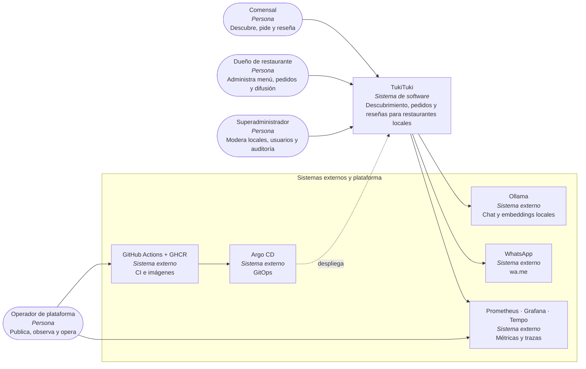
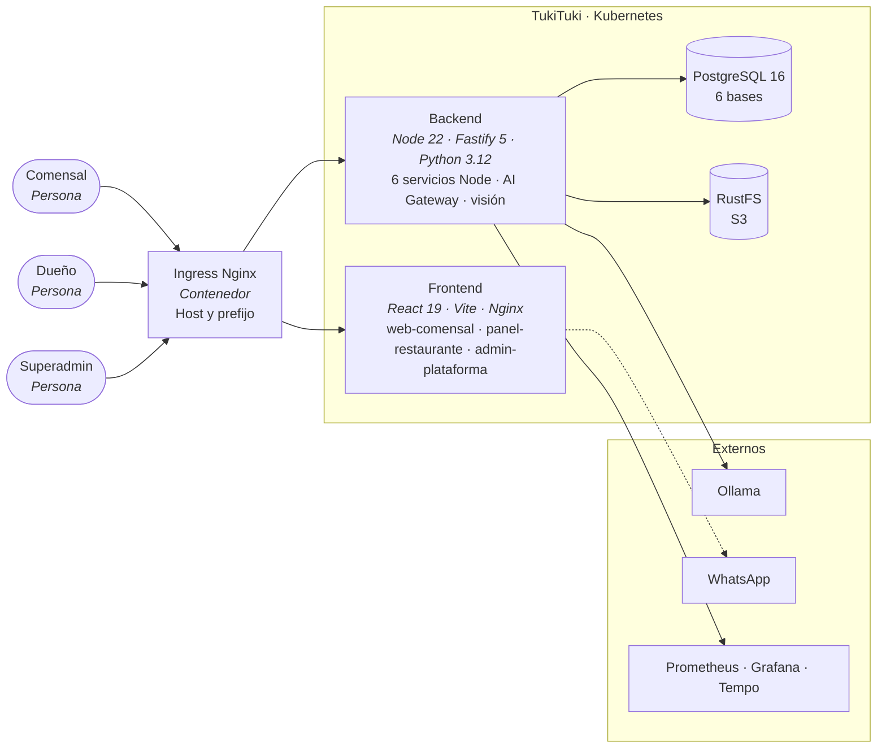
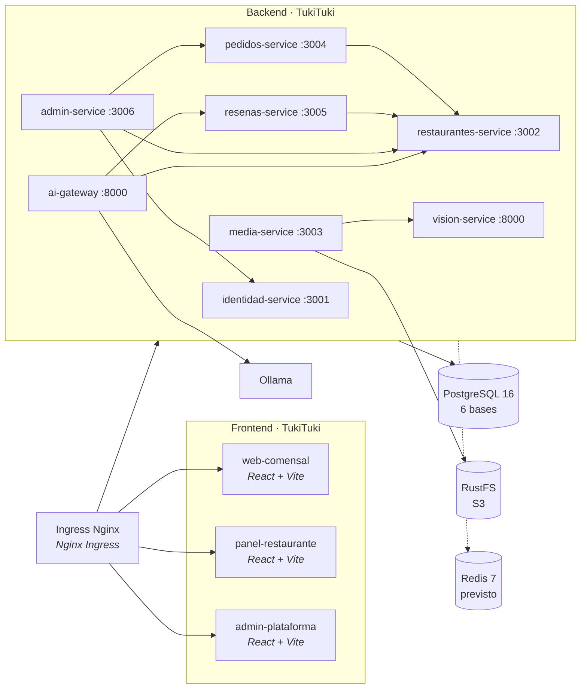

# Diagramas C4 de TukiTuki

| Campo | Valor |
| --- | --- |
| Versión | 2.1 |
| Fecha | 2026-11-25 |
| Alcance | Tres frontends, seis servicios Node, AI Gateway, visión, PostgreSQL, RustFS y borde HTTP |
| Niveles | N-1 contexto, N-2 contenedores agrupados, N-2.2 detalle de frontend y backend, N-3 componentes |
| Archivo editable | [`diagramas-c4.drawio`](diagramas-c4.drawio) |
| Fuentes | [`../README.md`](../README.md), [`../docs/arquitectura.md`](../docs/arquitectura.md), [`../docs/convenciones.md`](../docs/convenciones.md), [`../infra/docker/docker-compose.yml`](../infra/docker/docker-compose.yml), [`../infra/k8s`](../infra/k8s) |

## 1. Cómo leer estos diagramas

El modelo C4 describe la arquitectura en cuatro niveles. Este documento cubre los
tres primeros; el nivel de código (N-4) vive en el repositorio.

| Nivel | Pregunta que responde | Página del `.drawio` | Sección |
| --- | --- | --- | --- |
| N-1 | ¿Quién usa TukiTuki y de qué sistemas externos depende? | `N-1 Contexto` | §2 |
| N-2 | ¿Cómo se agrupan los bloques desplegables y qué consumen? | `N-2 Contenedores` | §3 |
| N-2.2 | ¿Qué contenedores hay dentro de frontend y backend? | `N-2.2 Frontend y Backend` | §3.1 |
| N-3.1 | ¿Qué hay dentro de los tres frontends? | `N-3.1 Frontends` | §4 |
| N-3.2 | ¿Qué hay dentro de los seis servicios Node? | `N-3.2 Servicios Node` | §5 |
| N-3.3 | ¿Qué hay dentro del AI Gateway y de visión? | `N-3.3 AI Gateway y Visión` | §6 |

Convenciones:

- **Persona**: un rol humano. No es una cuenta concreta.
- **Sistema externo**: servicio que TukiTuki consume o que la opera; no es lógica
  de negocio del monorepo.
- **Contenedor**: aplicación o almacén que se ejecuta por separado.
- **Componente**: unidad de responsabilidad dentro de un contenedor.
- **Relación**: dependencia en ejecución. La etiqueta dice qué viaja y la
  tecnología dice cómo.

El `.drawio` usa las formas C4 nativas de draw.io: `shape=mxgraph.c4.person2`
para personas, cajas `#1168BD` para sistemas, `#8C8496` para externos,
`#438DD5` para contenedores, `#85BBF0` para componentes, cilindros para datos y
fronteras punteadas `#666666`. Cada caja y cada flecha es un `<object>` con
`c4Name`, `c4Type`, `c4Technology` y `c4Description`, así que **Edit Data** en
draw.io muestra la misma información que la biblioteca C4.

> **Regla de honestidad.** Cada caja corresponde a una carpeta, un manifiesto o
> un recurso desplegado. Los pendientes conocidos se listan en §8 y no se dibujan
> como si ya existieran.

---

## 2. N-1 · Contexto

TukiTuki es una sola caja para quien no conoce el repositorio. Los tres públicos
entran por aplicaciones distintas, pero comparten el mismo backend.



Lo que el diagrama deja ver:

- **Tres audiencias, un producto.** El comensal usa `web-comensal`; el dueño,
  `panel-restaurante`; el superadmin, `admin-plataforma`. Las tres comparten
  contratos y backend.
- **La IA es local.** El chat y los embeddings corren en Ollama; no hay claves de
  terceros ni Groq.
- **WhatsApp es una salida del navegador.** El pedido se arma en el backend y el
  enlace `wa.me` se abre desde la interfaz.
- **La plataforma no es lógica de negocio.** GitHub Actions, GHCR, Argo CD,
  Prometheus, Grafana y Tempo condicionan la entrega y la operación, pero no
  aparecen como servicios del producto.

---

## 3. N-2 · Contenedores

El N-2 se lee en dos pasos. Primero, una vista agrupada: todo el frontend es un
bloque y todo el backend es otro. Así se entiende el sistema sin perderse en
once contenedores. Después, el N-2.2 abre esos dos bloques y enumera lo que hay
dentro.



Lectura:

- **Dos bloques desplegables.** El `Frontend` reúne las tres SPAs y los paquetes
  `@tuki/*`; el `Backend` reúne los seis servicios Node, el AI Gateway y visión.
- **El borde es uno solo.** El Ingress publica las SPAs y enruta `/v1/*` y
  `/api/v1/ai`; ningún frontend conoce la IP de un servicio.
- **Los almacenes no están dentro de los servicios.** PostgreSQL y RustFS son
  contenedores propios; Redis está previsto y se muestra en el N-2.2.
- **El detalle no se pierde.** La página N-2.2 enumera los once contenedores y
  las dependencias entre ellos; este N-2 solo agrupa.

### 3.1 N-2.2 · Detalle de frontend y backend

El N-2.2 es la vista que abre las dos cajas del N-2. El bloque `Frontend`
contiene tres aplicaciones; el bloque `Backend` contiene seis servicios Node y
un sub-bloque de IA con dos servicios Python.



| Bloque | Contenedores | Responsabilidad conjunta |
| --- | --- | --- |
| Frontend | `web-comensal`, `panel-restaurante`, `admin-plataforma` | Tres SPAs Vite que comparten `@tuki/api-cliente`, `@tuki/auth-react` y `@tuki/dominio` |
| Backend Node | `identidad-service` … `admin-service` | Seis servicios Fastify con una base lógica por servicio y contratos REST |
| Backend IA | `ai-gateway`, `vision-service` | Chat y RAG local, y clasificación de fotos; no leen PostgreSQL |
| Datos | `PostgreSQL 16`, `RustFS`, `Redis 7` | Una base por servicio, objetos S3 y caché/rate limit previsto |

Lectura:

- **Frontend = tres contenedores, no uno.** Cada SPA se despliega con su propio
  Nginx y su propio host; comparten paquetes, no proceso.
- **Backend = ocho contenedores.** Los seis Node son independientes; el AI
  Gateway y visión son Python y viven en un sub-bloque del mismo backend.
- **Dependencias síncronas.** `pedidos` y `resenas` consultan `restaurantes`;
  `admin-service` consulta identidad, restaurantes y pedidos; `ai-gateway`
  consulta restaurantes y reseñas; `media` consulta visión.
- **Datos fuera del proceso.** Todos los Node escriben en PostgreSQL; `media`
  además escribe objetos en RustFS. Redis aparece punteado porque está
  desplegado pero el rate limit sigue en memoria.
- **Una sola entrada.** El Ingress publica las tres SPAs y enruta las APIs; las
  flechas entre contenedores son REST directo solo dentro del backend.

### 3.2 Los mismos contenedores en cada entorno

| Elemento | Docker Compose | Kubernetes |
| --- | --- | --- |
| Borde | Traefik `:8088` → API Gateway Nginx `:8084` | Ingress Nginx con hosts y TLS |
| Frontends | `:8081`, `:8082`, `:8083` | 3 Deployments + Services `:80` |
| Servicios Node | `:3001`–`:3006` | 6 Deployments + Services |
| IA y visión | `:8000` y `:8002` | `ai-gateway` y `vision-service` `:8000` |
| PostgreSQL | `:5432`, seis bases | StatefulSet `postgres` `:5432` |
| Redis | `:6379` | Deployment `redis` `:6379` |
| Objetos | RustFS `:9000` y consola `:9001` | StatefulSet `rustfs` |
| Correo | Mailpit `:8025`/`:1025` | No se despliega |
| Observabilidad | Prometheus y Grafana en Compose | Prometheus Operator, Grafana, Tempo y OTel |

---

## 4. N-3.1 · Frontends

Los tres frontends son aplicaciones Vite independientes. Comensal y panel
reutilizan `@tuki/experiencia`; los tres comparten `@tuki/api-cliente`,
`@tuki/auth-react` y `@tuki/dominio`; `@tuki/ui-kit` lo usa la administración.

| Aplicación | Páginas o capacidades | Paquetes que usa |
| --- | --- | --- |
| `web-comensal` | Descubrir, ficha `/restaurante/:slug`, inspiración, cuenta, autenticación, QR, legales y `ChatRecomendador` | `experiencia`, `api-cliente`, `auth-react`, `dominio` |
| `panel-restaurante` | `PanelControl`: configuración, menú, pedidos, reseñas, apariencia y difusión; vista previa pública | `experiencia`, `api-cliente`, `auth-react`, `dominio` |
| `admin-plataforma` | `PanelAdmin`: panorama, locales, usuarios y auditoría; login y `RutaSuperadmin` | `api-cliente`, `auth-react`, `ui-kit`, `dominio` |

| Componente | Dónde vive |
| --- | --- |
| Entrada y rutas | `apps/*/src/main.tsx`, `apps/*/src/App.tsx` |
| Páginas públicas y de cuenta | `packages/experiencia-tuki/src/paginas/` |
| Panel del dueño | `packages/experiencia-tuki/src/paginas/PanelControl.tsx` |
| Chat del comensal | `packages/experiencia-tuki/src/componentes/chat/` |
| Módulos de dominio de la experiencia | `packages/experiencia-tuki/src/modulos/{cuenta,menu,pedidos,resenas}/` |
| Contratos HTTP | `packages/api-cliente/src/*.api.ts` |
| Sesión y guards | `packages/auth-react/src/` |
| Componentes visuales | `packages/ui-kit/src/` |
| Tipos y reglas compartidas | `packages/dominio/src/` |
| Configuración de URLs | `/config.js` generado por `infra/docker/gateway/generar-config.sh` o por el ConfigMap |

La regla de dependencia se mantiene: la presentación usa la aplicación, la
aplicación usa el dominio y la infraestructura implementa lo que el dominio
necesita. Ningún componente llama a `fetch` directamente.

---

## 5. N-3.2 · Servicios Node

Los seis servicios Node comparten la misma anatomía hexagonal:

```text
entrada/http/   rutas, controladores y esquemas Zod
plugins/        autenticación JWT, exigirRol y errores
aplicacion/     casos de uso
dominio/        reglas puras
puertos/        repositorios y clientes que necesita el núcleo
adaptadores/    PostgreSQL, HTTP, S3, JWT
composicion.ts  raíz de composición
```

| Servicio | Puerto | Responsabilidad | Base | Puertos propios |
| --- | --- | --- | --- | --- |
| `identidad-service` | `3001` | Cuentas, credenciales, roles, sesiones y superadmin | `tuki_identidad` | `UsuariosRepositorio`, `AuditoriaRepositorio`, `HasherPassword`, `TokensSesion` |
| `restaurantes-service` | `3002` | Locales, menú, cocinas, categorías, búsqueda y panel | `tuki_restaurantes` | `RestaurantesRepositorio`, `MenuRepositorio`, `PublicoRepositorio` |
| `media-service` | `3003` | Subida, clasificación, metadatos y objetos | `tuki_media` | `MediaRepositorio`, `AlmacenObjetos`, `ClasificadorImagenes` |
| `pedidos-service` | `3004` | Pedidos, ítems, totales y estados | `tuki_pedidos` | `PedidosRepositorio`, `RestaurantesCliente` |
| `resenas-service` | `3005` | Reseñas, respuestas, votos y moderación | `tuki_resenas` | `ResenasRepositorio`, `RestaurantesCliente` |
| `admin-service` | `3006` | BFF del superadmin y auditoría | `tuki_admin` | `ServiciosRemotos`, `AuditoriaRepositorio` |

Casos de uso principales:

- **Identidad**: registrar, iniciar sesión, refrescar, cerrar sesión, actualizar
  perfil, listar usuarios, cambiar rol y crear superadmin.
- **Restaurantes**: perfil del local, menú, público y administración de locales.
- **Medios**: subir media, listar las propias y validar tipo, tamaño y contenido.
- **Pedidos**: crear pedido, consultar, cambiar estado y resumen para admin.
- **Reseñas**: crear, listar, responder, eliminar, cambiar visibilidad y votos.
- **Administración**: panorama, listar restaurantes y usuarios, cambiar estado o
  rol y consultar la auditoría.

Dependencias síncronas:

- `pedidos-service` y `resenas-service` consultan `restaurantes-service`.
- `admin-service` consulta identidad, restaurantes y pedidos.
- `media-service` consulta `vision-service` y escribe en RustFS.
- No hay bus de eventos: la auditoría y las notificaciones son síncronas.

---

## 6. N-3.3 · AI Gateway y visión

Los dos servicios Python son hexagonales y no usan claves de terceros.

### 6.1 AI Gateway

| Componente | Responsabilidad |
| --- | --- |
| `entrada/` | FastAPI: `/api/v1/ai/chat`, `/recomendar`, `/conocimiento`, `/models`, salud y `/metrics` |
| `servicios/chat.py` | Valida el prompt y delega en `ProveedorIA` |
| `servicios/recomendador.py` | Extrae filtros, recupera platos, construye contexto y devuelve fuentes |
| `servicios/conocimiento.py` | Construye el índice RAG, lo refresca por TTL y conserva la última copia válida |
| `dominio/` | `Identity`, `RateDecision`, `ResultadoIA`, `Documento`, `Fuente`, `IndiceRAG`, BM25 + embeddings |
| `puertos/` | `ProveedorIA`, `ProveedorEmbeddings`, `Limitador`, `VerificadorIdentidad` |
| `adaptadores/ollama.py` | Chat y embeddings por HTTP |
| `adaptadores/restaurantes.py` | Extrae catálogo y fichas por REST |
| `adaptadores/memoria.py` | Token bucket en memoria: 10 rpm anónimo y 30 rpm autenticado |
| `adaptadores/supabase.py` | Identidad local HS256 y modo Supabase JWKS opcional |
| `observability.py` | Métricas, trazas OTLP y logs con request-id |

El índice RAG se construye con el catálogo real de `restaurantes-service` y las
reseñas de `resenas-service`; el gateway no lee PostgreSQL.

### 6.2 Visión

| Componente | Responsabilidad |
| --- | --- |
| `app/entrada/rutas.py` | `POST /api/v1/vision/clasificar`, `GET /modelo`, salud y preparación |
| `app/dominio/clasificador.py` | `ClasificadorComida`, `Veredicto`, `ErrorModelo` y umbral |
| `app/dominio/clasificador.py` | `ClasificadorYolo` sobre Ultralytics YOLO11n-cls |
| `app/modelos/comida-v1.pt` | Pesos locales; no se descargan en runtime |
| `app/config.py` | Umbral, ruta del modelo, device y límites de imagen |

`media-service` envía la foto como multipart. Si visión no está disponible,
`media-service` falla abierto y deja pasar la subida.

---

## 7. Trazabilidad con el repositorio

| Elemento C4 | Dónde vive |
| --- | --- |
| Frontends | `apps/web-comensal`, `apps/panel-restaurante`, `apps/admin-plataforma` |
| Paquetes compartidos | `packages/api-cliente`, `packages/auth-react`, `packages/dominio`, `packages/experiencia-tuki`, `packages/ui-kit`, `packages/observabilidad-node` |
| Servicios Node | `services/{identidad,restaurantes,media,pedidos,resenas,admin}-service` |
| AI Gateway | `services/ai-gateway/app/` |
| Visión | `services/vision-service/app/` |
| PostgreSQL y bases | `infra/docker/postgres/init/01-databases.sql`, `services/*/src/db/` |
| RustFS | `infra/docker/docker-compose.yml`, `infra/k8s/base/rustfs.yaml` |
| Ingress y borde local | `infra/k8s/base/ingress.yaml`, `infra/docker/gateway/api-gateway.conf` |
| Observabilidad | `infra/observability/`, `packages/observabilidad-node/` |
| GitOps y entrega | `.github/workflows/`, `infra/argocd/`, `infra/opentofu/` |

---

## 8. Decisiones y límites

| Decisión | Efecto en el diagrama |
| --- | --- |
| Microservicios con base por servicio | Seis contenedores Node y seis bases lógicas |
| Arquitectura hexagonal | En N-3.2 cada columna repite entrada → aplicación → dominio, con puertos y adaptadores |
| Datos dentro del clúster | PostgreSQL, Redis y RustFS son contenedores; Ollama, WhatsApp y GHCR son externos |
| N-2 agrupado y N-2.2 detallado | El N-2 muestra dos bloques; el N-2.2 enumera los once contenedores y sus dependencias |
| IA local | El AI Gateway apunta a Ollama, no a Groq |
| Sin bus de eventos | Las flechas entre servicios son REST síncrono |
| Un solo origen HTTP | Ingress o API Gateway Nginx; sin CORS en producción |

Pendientes que **no** se dibujan como si existieran:

- Bus de eventos (NATS o RabbitMQ) para notificaciones y auditoría asíncronas.
- Rate limit compartido en Redis; hoy es memoria del proceso.
- Trazas y logs agregados con Loki; Tempo ya recibe trazas.
- SSR del comensal si el SEO de las fichas pasa a ser obligatorio.

---

*Regla para mantenerlos: si una caja no se puede señalar en el repositorio o en
un recurso desplegado, no pertenece al diagrama. Si una flecha no se puede
justificar con una llamada real, tampoco.*
