# Patrones de diseño en Tuki

**Catálogo razonado, con evidencia en el código**

| Campo | Valor |
| --- | --- |
| Versión | 1.0 |
| Fecha | 2026-11-02 |
| Alcance | SPA React, módulos de dominio, AI Gateway y borde Nginx |
| Método | Solo se documenta un patrón si hay una implementación verificable en el repositorio |
| Documento relacionado | [`documento-arquitectura.md`](documento-arquitectura.md), [`mapa-modulos.md`](mapa-modulos.md) |

> **Criterio de honestidad.** Este documento no es un catálogo de GoF aplicado a la fuerza. Distingue tres niveles: **implementado** (el patrón existe y se usa), **preparado** (existe el contrato, pero el consumidor aún depende del concreto) y **ausente a propósito** (se decidió no usarlo). Un patrón mal aplicado es peor que su ausencia.

---

## 1. Mapa general

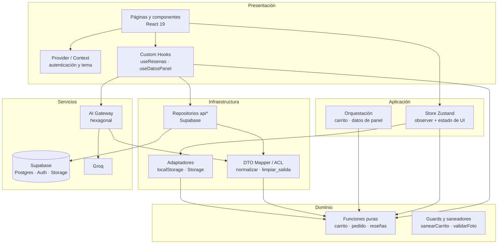

**Lectura.** El dominio puro es el centro; la infraestructura lo rodea y traduce tecnologías; la presentación solo consume hooks, stores y la API pública de cada módulo. El gateway repite la misma forma del lado servidor.

| # | Patrón | Familia | Estado | Evidencia principal |
| --- | --- | --- | --- | --- |
| 1 | Monolito modular + Facade | Arquitectónico | Implementado | `src/modulos/*/index.ts`; ADR 0007 |
| 2 | Hexagonal / Ports & Adapters | Arquitectónico | Implementado | `services/ai-gateway/app/puertos/__init__.py` |
| 3 | Capas con regla de dependencia | Arquitectónico | Implementado y verificado | `pnpm arquitectura` |
| 4 | Repository | Arquitectónico / datos | Implementado | `src/modulos/*/infraestructura/api*.ts` |
| 5 | Composition Root + DI | Creacional / estructural | Implementado | `app/composicion.py`; `Depends` |
| 6 | Proxy de mismo origen | Arquitectónico | Implementado | `docker/nginx/conf.d/default.conf` |
| 7 | Singleton | Creacional | Implementado | `src/lib/supabase.ts:13` |
| 8 | Factory Method | Creacional | Implementado | `create_app`, `RateLimiter.from_settings` |
| 9 | Strategy | Comportamiento | Implementado / parcial | `ProveedorIA` sí; `Limitador` preparado |
| 10 | Observer | Comportamiento | Implementado | Zustand; `onAuthStateChange` |
| 11 | Chain of Responsibility | Comportamiento | Implementado (pipeline) | middleware, `Depends`, exception handlers |
| 12 | Retry con backoff + fallback | Resiliencia | Implementado | `adaptadores/groq.py:93-96,222` |
| 13 | DTO + Mapper / ACL | Datos y contratos | Implementado | `normalizar`, `_parse_success`, `limpiar_salida` |
| 14 | Null Object / degradación | Comportamiento | Implementado | placeholders, adaptador de storage |
| 15 | Guard / Sanitizer | Datos y contratos | Implementado | `sanearCarrito`, `validarFoto`, Zod |
| 16 | Custom Hook (composición) | Presentación | Implementado | `useResenas`, `useDatosPanel` |

---

## 2. Patrones arquitectónicos

### 2.1 Monolito modular con Facade por módulo

**Intención.** Un solo despliegue, pero con fronteras internas explícitas. Cada módulo expone una única puerta pública y oculta sus capas.

**Dónde vive.** `src/modulos/pedidos/index.ts`, `menu`, `resenas`, `cuenta`. El resto de la aplicación importa solo desde ese archivo; `scripts/verificar-arquitectura.mjs` falla si alguien entra a `dominio/`, `aplicacion/` o `infraestructura/` de otro módulo.

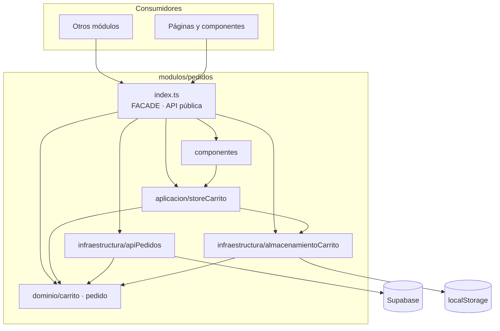

**Ventaja.** Se puede cambiar la persistencia o extraer el módulo a servicio sin tocar consumidores. Es la preparación del *strangler fig* descrito en el documento de arquitectura.

**Coste.** El `export *` del dominio puede filtrar más de lo necesario; conviene exportar nombres explícitos cuando el módulo crezca.

**Evidencia.** `src/modulos/pedidos/index.ts:9-13`; `docs/arquitectura/mapa-modulos.md`.

---

### 2.2 Hexagonal (Ports & Adapters) en el AI Gateway

**Intención.** El caso de uso no conoce Groq, FastAPI ni Redis. Solo conoce contratos. Los detalles se enchufan desde fuera.

**Dónde vive.** `services/ai-gateway/app/`:

```text
dominio/      modelos y errores sin dependencias
puertos/      Protocol: ProveedorIA, Limitador, VerificadorIdentidad
servicios/    ServicioChat (caso de uso)
adaptadores/  GroqClient, RateLimiter, Supabase JWKS
entrada/      rutas, dependencias, middleware, errores
composicion.py  única pieza que conoce las implementaciones
```

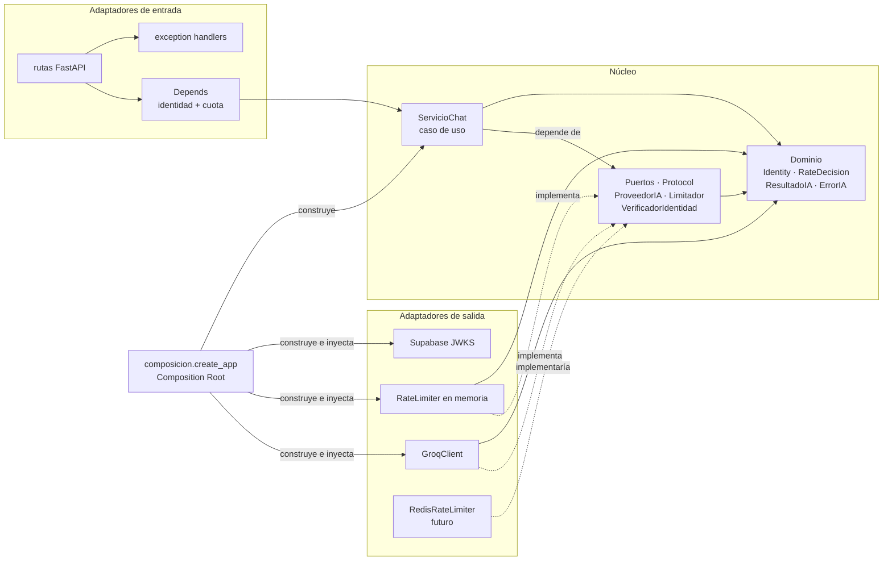

**Regla que se cumple.** `dominio` no importa FastAPI, `httpx` ni Groq; `servicios` no importa adaptadores; los adaptadores dependen del dominio y de los puertos, nunca al revés. `composicion.py` es el único lugar con `new` concretos.

**Ventaja real.** Cambiar Groq por otro proveedor o el limitador por Redis es un archivo nuevo y una línea en `create_app`, no una reescritura de endpoints.

**Límite actual.** El puerto `Limitador` existe, pero `entrada/dependencias.py:57` tipa el `RateLimiter` concreto. La estrategia está **preparada**, no cerrada: para cambiar a Redis hay que ajustar el tipo de la dependencia y la inyección, no solo el adaptador.

**Evidencia.** `app/puertos/__init__.py:15-42`; `app/servicios/chat.py:15-28`; `app/composicion.py:37-82`.

---

### 2.3 Capas con regla de dependencia verificada

**Intención.** Las dependencias apuntan hacia el dominio. Un componente no consulta Supabase; un adaptador no importa React.

**Implementación.** No es solo una convención escrita: `pnpm arquitectura` la comprueba en TypeScript y Python. Las cuatro capas son opcionales; lo prohibido es saltarse la dirección.

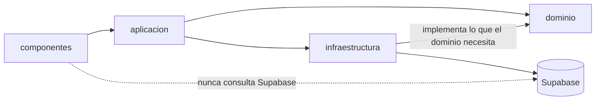

**Ventaja.** El dominio se prueba sin navegador ni red: `tests/frontend/pedidos.test.ts` importa solo `dominio/carrito`. Un cambio de proveedor es un adaptador.

**Coste.** La regla se verifica por rutas de importación, no por tipos. Un `any` puente puede violar el espíritu aunque pase el script.

**Evidencia.** `scripts/verificar-arquitectura.mjs`; `docs/adr/0007-monolito-modular.md`.

---

### 2.4 Repository

**Intención.** Concentrar el acceso a datos y traducir filas de Postgres al modelo del dominio. El resto del código no escribe consultas.

**Dónde vive.** `apiPedidos`, `apiResenas`, `apiCuenta`, `apiPlatillos`, `apiRestaurante`, cada uno como objeto con métodos (`crear`, `listar`, `mias`, `cambiarEstado`).

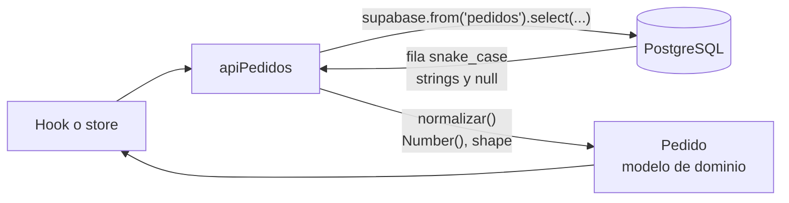

**Ventaja.** Una sola definición de `CAMPOS` y una sola normalización de `subtotal`/`total`. Cambiar el esquema afecta a un archivo, no a diez componentes.

**Coste.** No hay interfaz explícita: el "contrato" es la forma del objeto exportado. Los métodos devuelven `{ data, error }` en lugar de lanzar, así que el llamador puede ignorar el error con facilidad. En `apiPedidos.crear`, el error se ignora a propósito porque el pedido ya salió por WhatsApp; es una decisión de negocio, no un descuido.

**Evidencia.** `src/modulos/pedidos/infraestructura/apiPedidos.ts:23-95`; `src/modulos/resenas/infraestructura/apiResenas.ts:23-58`.

---

### 2.5 Composition Root + Dependency Injection

**Intención.** Un solo lugar ensambla objetos; el resto recibe dependencias ya construidas. Esto hace testeable el caso de uso sin FastAPI.

**Dónde vive.** `create_app` crea el cliente HTTP, el limitador, el `GroqClient` y el `ServicioChat`, y los guarda en `app.state`. Las rutas los reciben con `Depends`.

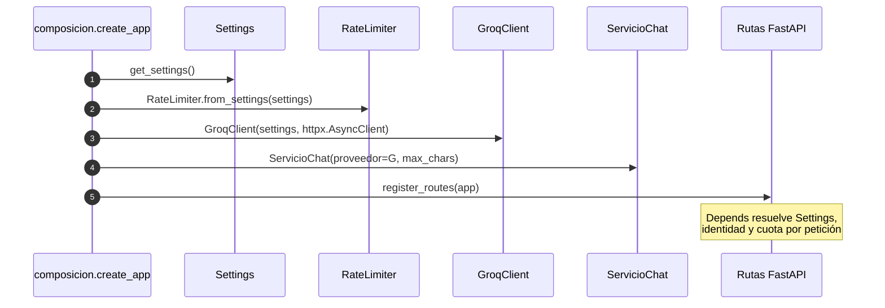

**Ventaja.** `create_app(settings)` permite probar con otra configuración sin tocar el contrato HTTP. El `ServicioChat` se testea con un doble de `ProveedorIA`.

**Coste.** `app.state` es un *service locator* de facto para settings y limitador. Es aceptable en FastAPI por su ciclo de vida, pero abusar de él difumina las dependencias.

**Evidencia.** `app/composicion.py:37-90`; `app/entrada/dependencias.py:21-76`; `app/entrada/rutas.py:83-84`.

---

### 2.6 Proxy de mismo origen

**Intención.** Evitar CORS y un origen extra: la SPA y la API se sirven desde el mismo dominio; Nginx decide qué va a estáticos y qué al gateway.

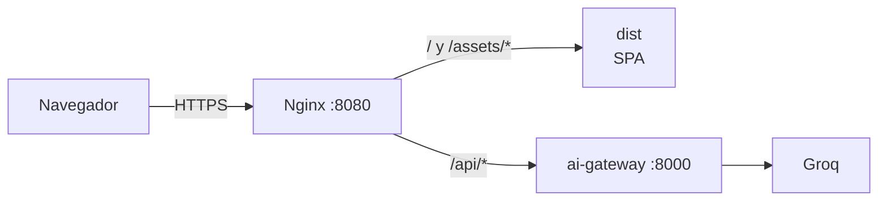

**Ventaja.** CSP más estricta, sin preflight, sin cookies de terceros y una sola URL pública. Si el gateway cae, la SPA sigue sirviéndose y solo `/api` devuelve 502.

**Coste.** Nginx se convierte en punto único de entrada; se compensa con réplicas y sondas. El `proxy_pass` usa un upstream estático `backend:8000`, válido en Compose y en el Service de Kubernetes.

**Evidencia.** `docker/nginx/conf.d/default.conf:44-70`.

---

## 3. Patrones creacionales

### 3.1 Singleton: cliente de Supabase

**Intención.** Una sola instancia del cliente con sesión compartida. Si cada componente creara la suya, habría múltiples listeners de auth y tokens desincronizados.

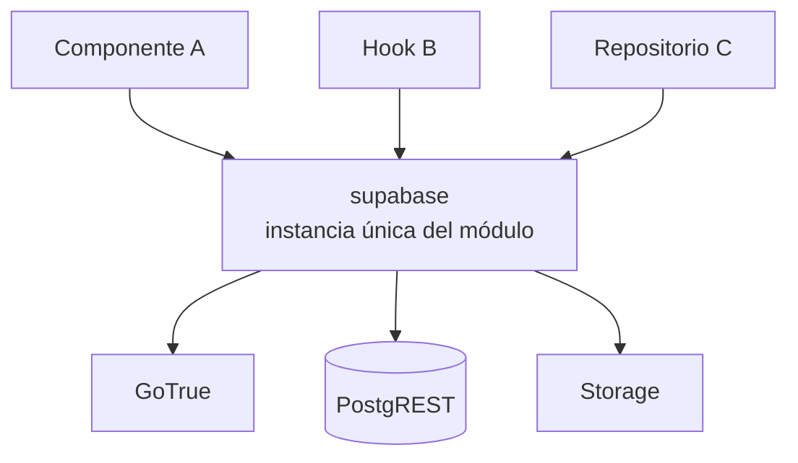

**Implementación.** `src/lib/supabase.ts:13` crea el cliente a nivel de módulo. El módulo ES se evalúa una vez por *bundle*.

**Ventaja.** Sesión coherente y un solo canal de Realtime.

**Coste.** Dificulta el *mocking* en pruebas; por eso las pruebas del dominio no lo tocan. El *fallback* a `https://placeholder.supabase.co` permite que la app arranque con configuración ausente, pero puede ocultar un error de despliegue si no se acompaña de una sonda de readiness.

**Evidencia.** `src/lib/supabase.ts:7-13`.

---

### 3.2 Factory Method

**Intención.** Crear objetos cuya configuración depende del entorno sin esparcir condicionales.

| Fábrica | Qué produce | Dónde |
| --- | --- | --- |
| `create_app(settings)` | Aplicación FastAPI cableada | `app/composicion.py:37` |
| `RateLimiter.from_settings(settings)` | Limitador con reglas anónimo/usuario | `app/adaptadores/memoria.py:35` |
| `createClient(url, key)` | Cliente Supabase | `src/lib/supabase.ts:13` |

**Ventaja.** La configuración se valida y se aplica en un punto. `from_settings` permite construir el limitador con cuotas distintas en pruebas.

**Coste.** `create_app` hace demasiado si sigue creciendo: telemetría, CORS, lifespan, rutas y errores. Es el lugar natural para extraer módulos de composición cuando se añadan Redis y worker.

---

## 4. Patrones de comportamiento

### 4.1 Strategy

**Intención.** Intercambiar algoritmos o proveedores sin tocar el caso de uso.

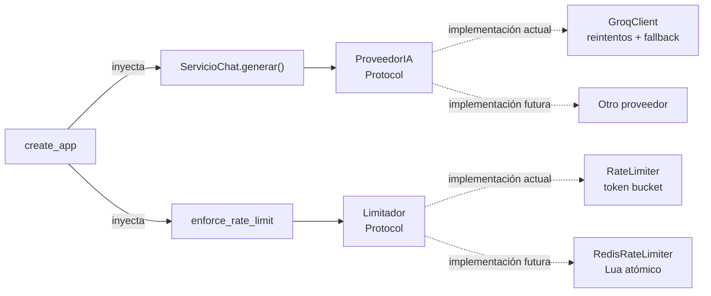

**Estado real.**

- `ProveedorIA` **sí** es Strategy completo: `ServicioChat` solo ve el Protocol y `GroqClient` lo implementa estructuralmente.
- `Limitador` está **preparado**: el Protocol existe y el adaptador lo cumple, pero la dependencia HTTP aún tipa `RateLimiter`. Migrar a Redis exige cambiar el tipo y la inyección, no solo añadir un archivo.

**Ventaja.** Añadir un proveedor con *fallback* o un limitador distribuido no cambia el endpoint ni el dominio.

**Coste.** Un Protocol sin consumidor polimórfico es documentación ejecutable, no inversión completa. Se cierra en la fase 1 del plan de evolución.

**Evidencia.** `app/puertos/__init__.py:15-42`; `app/servicios/chat.py:15-28`; `app/entrada/dependencias.py:54-60`.

---

### 4.2 Observer

**Intención.** Que la interfaz reaccione a cambios de estado sin que el emisor conozca a los consumidores.

**Dos implementaciones reales:**

1. **Zustand** (`useStoreCarrito`): los componentes se suscriben con selectores; `set({ carrito })` notifica y provoca re-render. El store no importa ningún componente.
2. **Supabase Auth**: `onAuthStateChange` notifica login/logout; `ProveedorAutenticacion` actualiza el contexto y todos los consumidores de `useAuth` se re-renderizan.

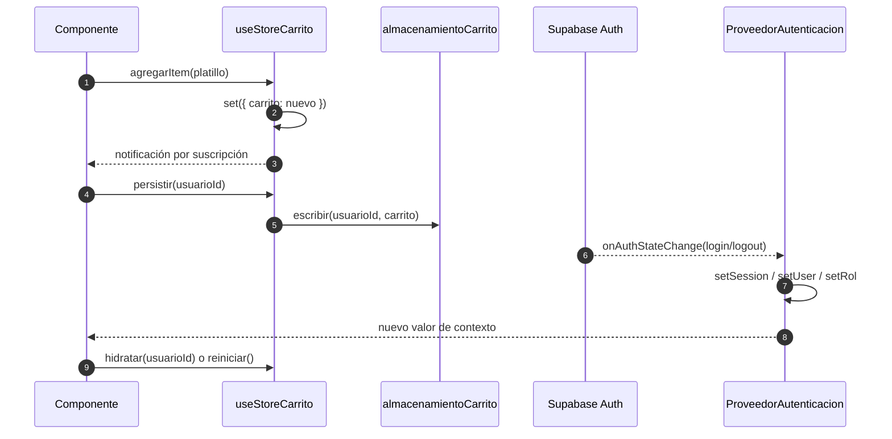

**Ventaja.** Desacoplamiento real: el carrito no sabe quién lo pinta; el proveedor de auth no sabe qué pantalla reacciona.

**Coste.** Las suscripciones mal seleccionadas re-renderizan de más. Zustand evita parte del problema con selectores, pero `useStoreCarrito()` sin selector devuelve el estado completo y acopla el componente a cualquier cambio.

**Evidencia.** `src/modulos/pedidos/aplicacion/storeCarrito.ts:46`; `src/contexto/ContextoAutenticacion.tsx:28-55`; `src/contexto/ContextoTema.tsx`.

---

### 4.3 Chain of Responsibility (pipeline HTTP)

**Intención.** Encadenar pasos que procesan una petición antes de llegar al caso de uso: identificarla, autenticarla, limitarla, registrar y normalizar errores.

**Dónde vive.** Middleware de FastAPI, `Depends` y `register_exception_handlers`. No hay una clase `Handler` con `setNext`: es la variante *pipeline* del patrón, la que ofrece el framework.

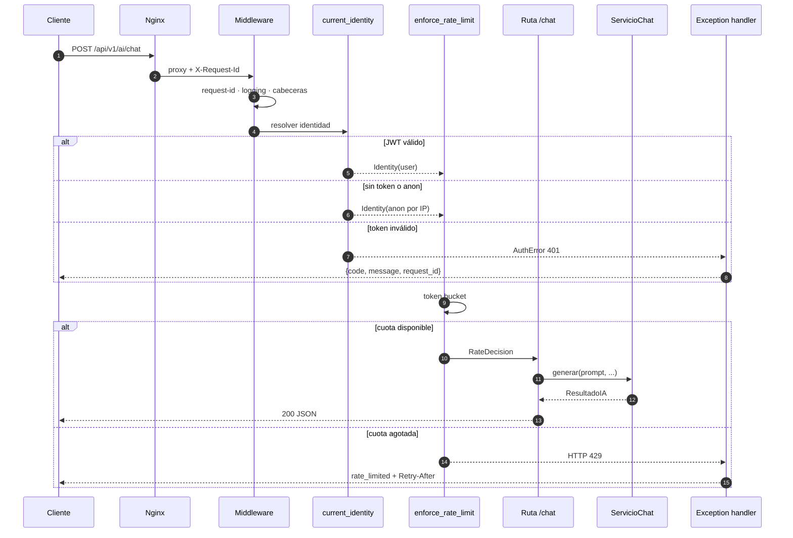

**Ventaja.** Cada paso tiene una responsabilidad y se prueba por separado. Los errores salen siempre con la misma forma (`{ detail: { code, message }, request_id }`), lo que simplifica la SPA.

**Coste.** El orden importa y no es evidente: identidad antes que cuota, cuota antes que caso de uso. Un middleware nuevo puede alterar latencia o headers sin que las pruebas de dominio lo detecten.

**Evidencia.** `app/entrada/middleware.py`; `app/entrada/dependencias.py:31-76`; `app/entrada/errores.py:29-90`; `docker/nginx/conf.d/default.conf`.

---

### 4.4 Retry con backoff y fallback de modelo

**Intención.** Absorber fallos transitorios de un proveedor externo sin degradar al usuario ni multiplicar el coste.

**Implementación real.** `GroqClient.generate` recorre una lista de modelos; por cada modelo intenta hasta `groq_max_attempts`; ante 429/5xx/red aplica backoff exponencial con *jitter* y respeta `Retry-After`; ante 404 o modelo inválido pasa al siguiente; ante 401/403 corta y devuelve error de configuración; con un *deadline* total, no se queda colgado.

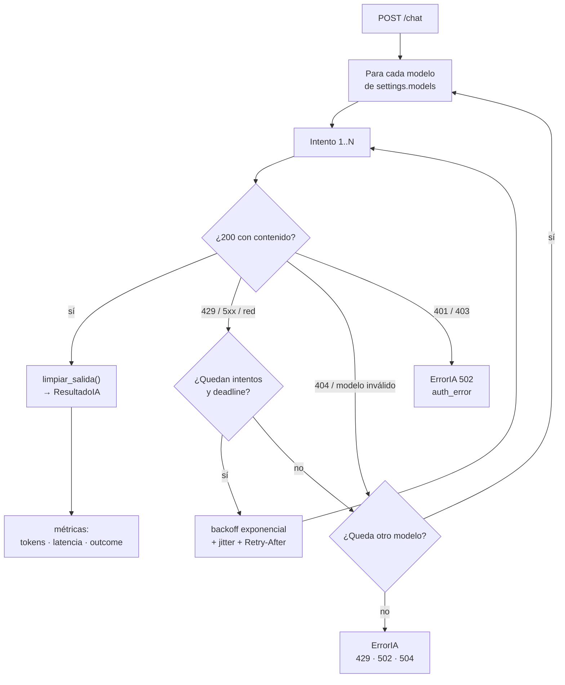

**Ventaja.** Un modelo retirado o un 429 de Groq no rompe la experiencia; el usuario recibe respuesta de otro modelo o un error claro con `Retry-After`.

**Coste.** No hay *circuit breaker*: si Groq está caído, cada petición paga el coste completo de reintentos y *fallback* antes de fallar. El *deadline* total acota el daño, pero no evita la estampida. La fase 2–3 del plan puede añadir un breaker en el adaptador.

**Evidencia.** `services/ai-gateway/app/adaptadores/groq.py:93-99,184-229`.

---

## 5. Patrones de datos y contratos

### 5.1 DTO + Mapper / Anti-Corruption Layer

**Intención.** Aislar el dominio de la forma exacta que devuelve Postgres o un proveedor de IA. El dominio no ve `snake_case`, `null` ni `choices[0].message.content`.

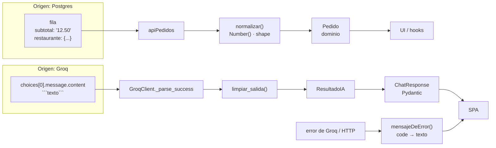

**Implementaciones.**

- `normalizar` convierte `subtotal` y `total` a número y conserva la forma del dominio.
- `limpiar_salida` elimina bloques de código, etiquetas («Eslogan:») y comillas tipográficas; se aplica en el adaptador y de nuevo en el cliente.
- `mensajeDeError` traduce códigos del gateway (`rate_limited`, `ai_timeout`, `prompt_too_long`) a mensajes de interfaz.
- Los esquemas Pydantic (`ChatRequest`, `ChatResponse`) son el contrato HTTP.

**Ventaja.** Cambiar el proveedor de IA o una columna no propaga el cambio a la UI; el punto de traducción es único.

**Coste.** Hay duplicación deliberada de `limpiarSalida` en cliente y servidor: el servidor normaliza la respuesta y el cliente se protege de un gateway antiguo. Es defensa en profundidad, no descuido, pero debe documentarse para no divergir.

**Evidencia.** `apiPedidos.ts:23-26`; `groq.py:38-41,231-270`; `servicioGroq.ts:33-45,119`; `schemas.py`.

---

### 5.2 Null Object y degradación elegante

**Intención.** Un fallo de un servicio auxiliar no debe romper el flujo principal.

| Situación | Comportamiento | Dónde |
| --- | --- | --- |
| Sin configuración de Supabase | Cliente con URL *placeholder*; la app arranca y falla al consultar | `src/lib/supabase.ts:8-13` |
| `localStorage` no disponible o lleno | El carrito sigue en memoria; no lanza | `almacenamientoCarrito.ts:22-39` |
| Sin sesión | El gateway aplica cuota anónima por IP | `adaptadores/supabase.py:47-60` |
| Auth desactivada en local | Identidad por IP, sin JWT | `AI_AUTH_MODE=disabled` |
| Fallo al guardar el pedido | No bloquea: el pedido ya salió por WhatsApp | `apiPedidos.ts` |

**Ventaja.** La compra y la navegación no dependen de servicios no críticos. Es la misma filosofía que hace que la SPA siga en pie si el gateway cae.

**Coste.** El *placeholder* de Supabase puede ocultar un despliegue mal configurado. La mitigación correcta no es lanzar en el cliente, sino una sonda de *readiness* y una verificación en el build, que ya existe para `VITE_SUPABASE_*`.

**Evidencia.** `src/lib/supabase.ts`; `almacenamientoCarrito.ts`; `docker/nginx/conf.d/default.conf:44-70`.

---

### 5.3 Guard / Sanitizer

**Intención.** Validar en el borde y sanear lo que viene de almacenamiento o de un usuario.

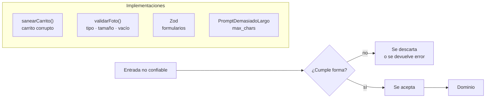

**Ventaja.** Un carrito manipulado en `localStorage` no rompe el checkout; una foto de 20 MB se rechaza antes de subir; un prompt gigante no consume tokens.

**Coste.** La validación de dominio y la de transporte pueden divergir. `sanearCarrito` protege la hidratación, pero no sustituye a RLS ni a la validación del servidor.

**Evidencia.** `src/modulos/pedidos/dominio/carrito.ts:84-99`; `src/lib/imagenes.ts:27-45`; `app/servicios/chat.py:24-26`.

---

### 5.4 Custom Hook (composición sobre herencia)

**Intención.** Encapsular estado asíncrono y efectos reutilizables sin clases ni herencia.

**Dónde vive.** `useResenas`, `useDatosPanel`, `useDatosEnvio`, `useAuth`.

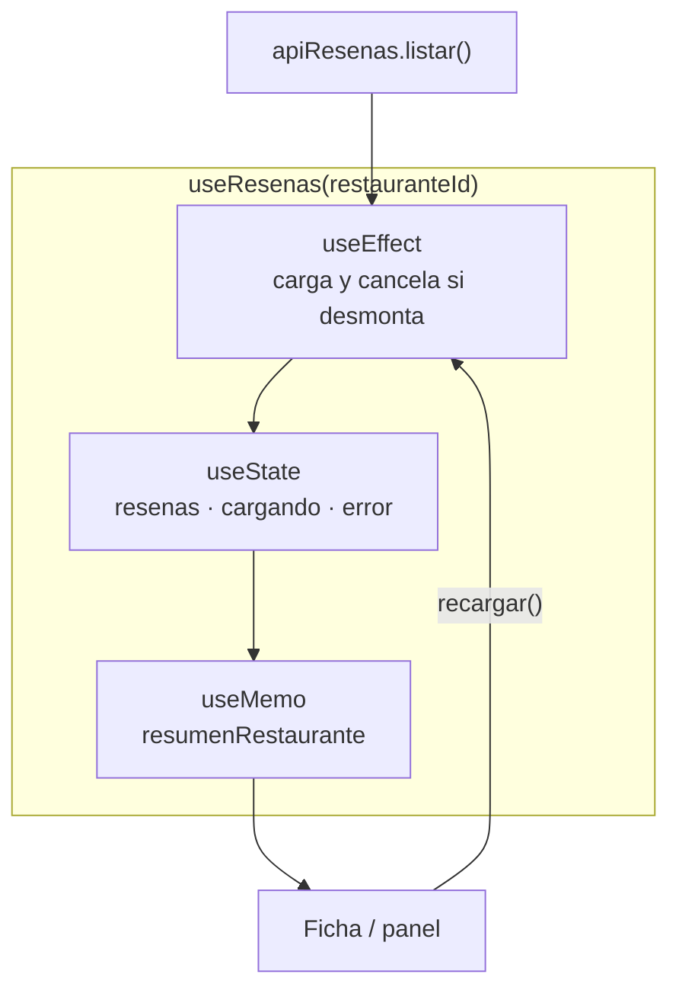

**Ventaja.** La ficha y el panel comparten exactamente la misma consulta y el mismo resumen; no hay dos versiones del cálculo. El hook cancela la actualización si el componente se desmontó (`vigente = false`), evitando *setState* sobre un componente muerto.

**Coste.** Cada hook implementa su propio `cargando/error/version`; no hay caché compartida ni deduplicación. Dos componentes que piden las mismas reseñas lanzan dos consultas. Es el problema que resolvería una capa de *query cache* o el futuro BFF.

**Evidencia.** `src/modulos/resenas/aplicacion/useResenas.ts:12-59`; `src/modulos/menu/aplicacion/useDatosPanel.ts`; `src/modulos/cuenta/aplicacion/useDatosEnvio.ts`.

---

## 6. Patrones ausentes a propósito

| Patrón | Por qué no se usa |
| --- | --- |
| **Microservicios** | Un equipo, un dominio transaccional y un despliegue conjunto; partirlos ahora crearía un monolito distribuido (ADR 0007) |
| **Redux / Event Sourcing** | El estado es pequeño y local; Zustand cubre el carrito sin *boilerplate* |
| **Service Locator global** | `app.state` se usa solo en el borde de FastAPI; inyectar un contenedor global ocultaría dependencias |
| **Herencia profunda / Template Method** | La composición con funciones puras y Protocols es más simple y testeable |
| **ORM en el frontend** | Supabase ya expone PostgREST; un ORM añadiría peso y otra capa de traducción |
| **Circuit breaker** | Útil, pero prematuro con un solo proveedor y un *deadline* total; se evaluará con el worker y Redis |
| **CQRS** | No hay dos modelos de lectura/escritura con requisitos distintos; el coste supera el beneficio |

---

## 7. Deuda y antipatrones observados

| Observación | Por qué importa | Mitigación |
| --- | --- | --- |
| Repositorios devuelven `{ data, error }` en vez de lanzar | El llamador puede ignorar el error; el tipo de error no está unificado | Unión discriminada `Resultado<T>` o excepción de dominio |
| `normalizar(fila: any)` y `map((fila: any) => ...)` | El `any` anula el tipado justo en la frontera más frágil | Tipos generados desde el esquema o Zod en el borde |
| El Protocol `Limitador` no se usa en la firma HTTP | La estrategia está a medias; cambiar a Redis toca más de lo que parece | Tipar `Limitador` en `dependencias.py` y resolver por `Depends` |
| Hooks sin caché compartida | Consultas duplicadas y parpadeos al navegar | *Query cache* o BFF en fase 1 |
| Store con `modalAbierto` junto al carrito | Mezcla estado de UI con estado de aplicación | Separar `storeCarrito` de `storeUI` si crece |
| Singleton de Supabase | Dificulta pruebas y *mocking* | Mantener dominio puro; inyectar cliente en tests de integración |
| `create_app` concentra composición y ciclo de vida | Crecerá con Redis, worker y OTEL | Extraer `componer_gateway`, `componer_observabilidad` |

---

## 8. Resumen en una frase por patrón

1. **Facade:** cada módulo enseña una puerta y esconde cuatro habitaciones.
2. **Hexagonal:** el caso de uso dicta el contrato; Groq obedece.
3. **Capas:** las flechas apuntan al dominio, y un script lo vigila.
4. **Repository:** ninguna consulta SQL fuera de `infraestructura`.
5. **Composition Root:** un solo archivo sabe qué implementación se usa.
6. **Proxy:** mismo origen, cero CORS, una sola puerta.
7. **Singleton:** una sesión, un cliente, un Realtime.
8. **Factory:** la configuración decide el objeto, no el consumidor.
9. **Strategy:** cambiar de proveedor es añadir un archivo, no editar el endpoint.
10. **Observer:** el estado avisa; la interfaz escucha.
11. **Chain:** identidad, cuota, ruta y error, en ese orden.
12. **Retry/fallback:** si un modelo falla, otro responde; si todos fallan, el error es claro.
13. **ACL:** Postgres y Groq hablan idiomas distintos; el mapper traduce.
14. **Null Object:** sin almacenamiento se sigue comprando; sin gateway se sigue navegando.
15. **Guard:** lo corrupto se descarta antes de tocar el dominio.
16. **Custom Hook:** la lógica de carga se compone, no se hereda.

---

*Regla para añadir un patrón: primero el problema, luego el patrón, nunca al revés. Si no se puede señalar el archivo y la línea donde vive, no está en la arquitectura: está en una diapositiva.*
