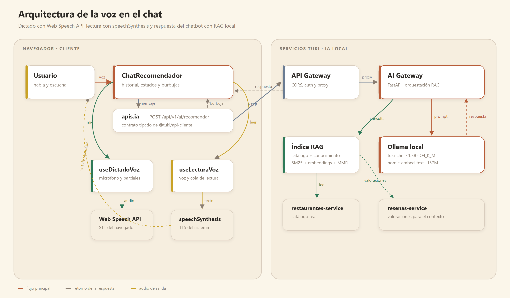
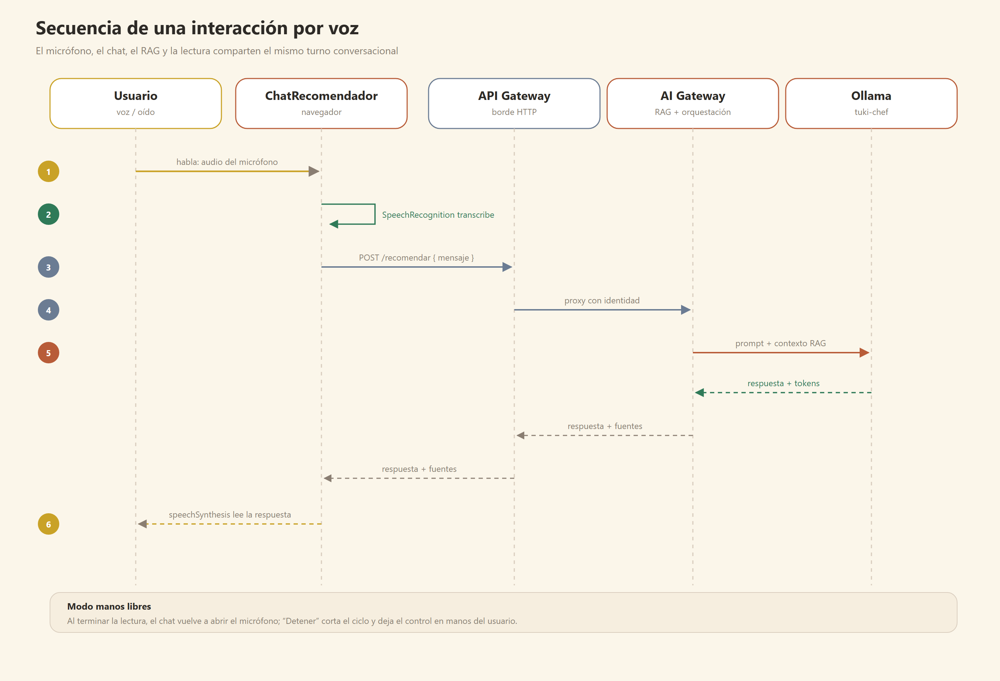
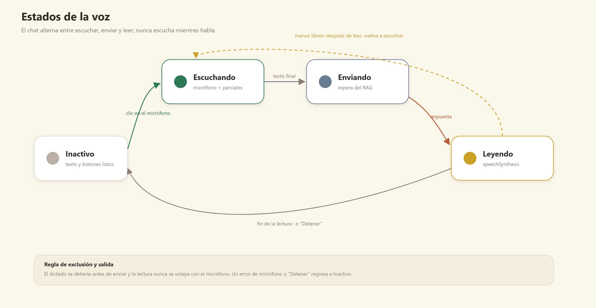
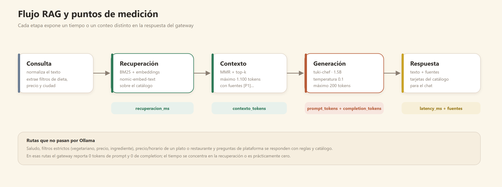
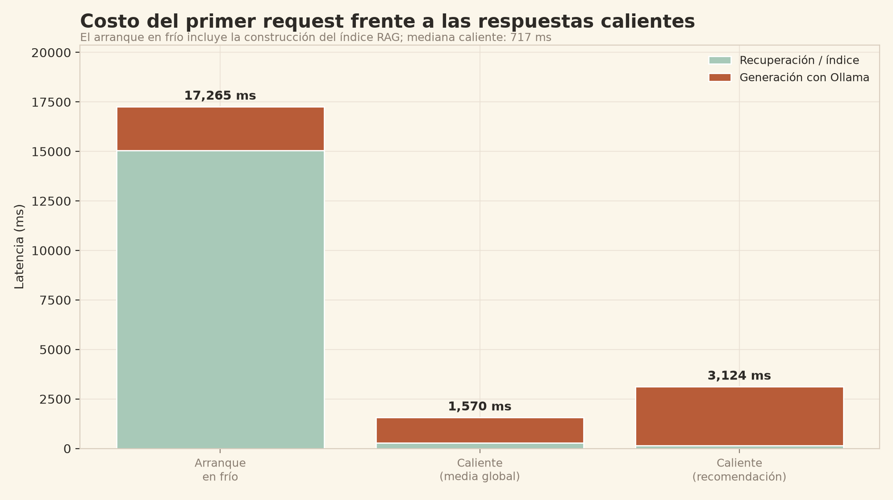
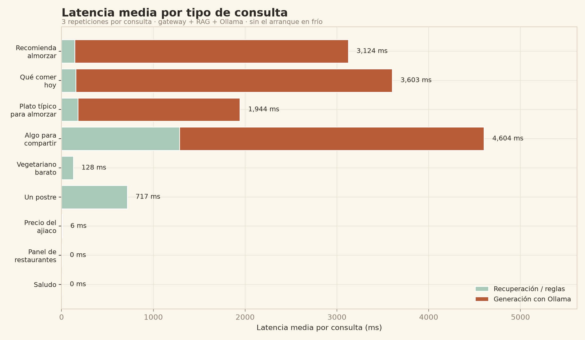
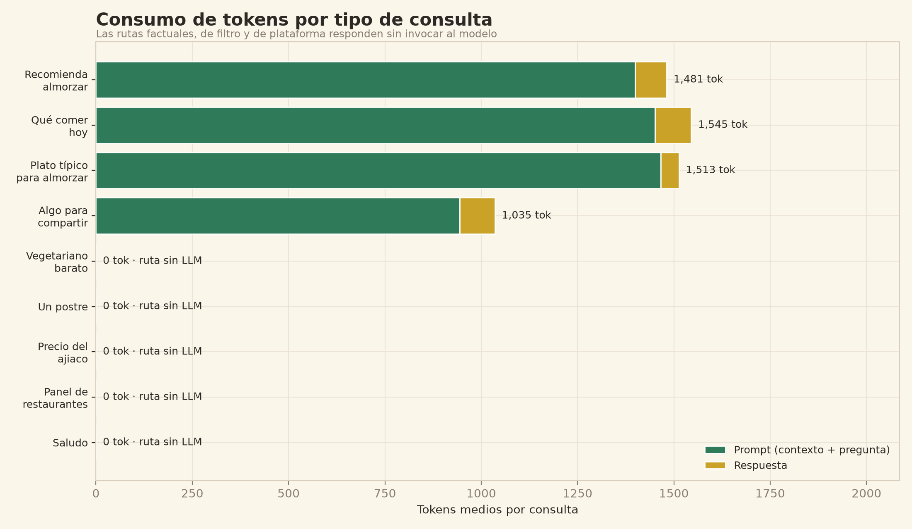
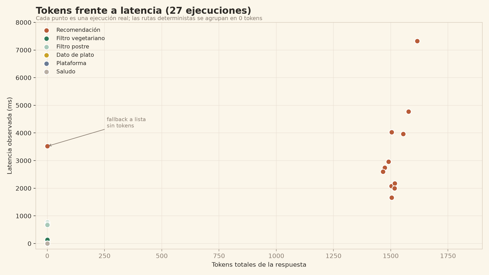
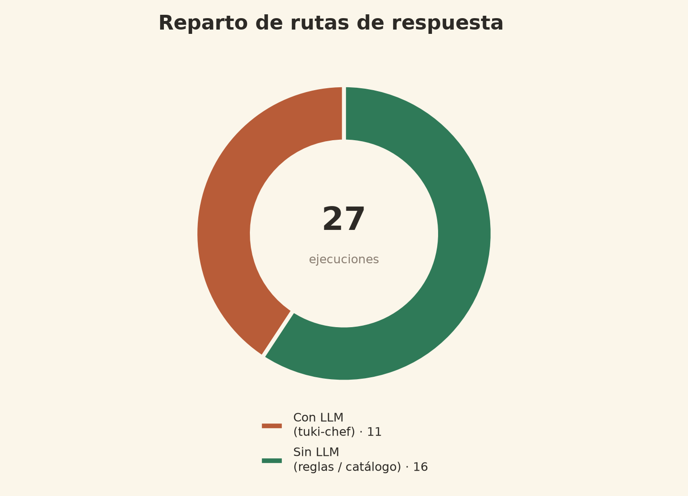

# Voz en el chat de Tuki y métricas del chatbot

**Versión PDF:** [voz-chat-metricas.pdf](voz-chat-metricas.pdf)

**Alcance:** este documento cubre únicamente la implementación de voz del chat y la medición real de tokens y tiempos del chatbot. No describe otras funcionalidades de TukiTuki.

**Fecha de medición:** 25 de noviembre de 2026, 14:54 (UTC−5).

---

## 1. Qué se implementó

El chat de `web-comensal` ahora permite hablarle a Tuki, leer sus respuestas y mantener un modo manos libres. La inteligencia sigue siendo el mismo chatbot de texto con RAG sobre el catálogo real: la voz se resuelve en el navegador y no agrega llamadas al gateway.

| Control | Comportamiento |
|---|---|
| Micrófono | Inicia el dictado con `SpeechRecognition` en `es-CO`. Muestra la transcripción parcial y entrega el texto final al chat. |
| Altavoz | Activa o desactiva la lectura automática de las respuestas. La preferencia se guarda en `localStorage` con la clave `tuki-chat-leer`. |
| Ondas | Activa el modo manos libres: al terminar de dictar se envía solo, la respuesta se lee y, al terminar la lectura, el micrófono se vuelve a abrir. |
| Escuchar | Lee una respuesta concreta de Tuki con `speechSynthesis`. |
| Repetir | Vuelve a leer el mensaje que escribiste o dictaste. |
| Detener | Corta el dictado o la lectura y desactiva el ciclo de manos libres. |

### 1.1 Piezas de software

- `packages/experiencia-tuki/src/componentes/chat/voz.ts`
  - `useDictadoVoz`: micrófono, parciales, texto final, errores y limpieza.
  - `useLecturaVoz`: voces del sistema, selección de la mejor voz española, limpieza del texto y cola de lectura.
  - `limpiarParaLeer`: quita citas `[P1]`, enlaces, marcas de Markdown y emojis antes de hablar.
- `packages/experiencia-tuki/src/componentes/chat/ChatRecomendador.tsx`
  - Botones de micrófono, altavoz y manos libres.
  - Barra de estado: “Escuchando…”, “Leyendo la respuesta…”, “Detener”.
  - Integración con `apis.ia.recomendar`, sin cambios en el contrato del backend.
- `packages/api-cliente/src/ai.api.ts`
  - Sin cambios: sigue recibiendo `{ mensaje, historial }` y devolviendo la respuesta y las fuentes.

### 1.2 Manejo de errores

- Permiso de micrófono denegado.
- Micrófono ocupado por otra aplicación.
- Silencio o ausencia de voz.
- Navegador sin `SpeechRecognition`.
- Fallo de red del motor de dictado del navegador.
- Cualquier error o el botón “Detener” regresan el chat a `Inactivo`.

### 1.3 Límites de la implementación

- El dictado usa el motor de voz del navegador. En Chrome y Edge puede apoyarse en un servicio del fabricante; en Firefox `SpeechRecognition` no está disponible.
- La lectura usa las voces instaladas en el sistema operativo, por lo que esa parte es local.
- El audio no se almacena en TukiTuki.
- El micrófono requiere `localhost` o HTTPS.
- La voz no cambia el contrato del chatbot ni el consumo de tokens del RAG: el texto transcrito entra por el mismo endpoint.

### 1.4 Verificación funcional

- `pnpm typecheck`, `pnpm test` y `pnpm build` pasan sin errores.
- En Chromium se verificó la presencia y el estado de los controles de micrófono, altavoz y manos libres.
- Con un `SpeechRecognition` simulado se comprobó el flujo completo: transcripción → envío → respuesta → estado de lectura.
- La captura con micrófono físico no se automatizó porque depende del permiso del usuario y del dispositivo; el flujo de voz real se prueba abriendo el chat en el navegador.

---

## 2. Arquitectura

<figure>
  
  <figcaption>Figura 1. Componentes del cliente, servicios Tuki y modelos locales.</figcaption>
</figure>

La arquitectura separa tres responsabilidades:

1. **El navegador** captura y reproduce la voz. `ChatRecomendador` coordina la interfaz; `useDictadoVoz` y `useLecturaVoz` encapsulan los navegadores.
2. **El borde HTTP** transporta el mensaje ya transcrito. `apis.ia` llama a `/api/v1/ai/recomendar` a través del API Gateway.
3. **El AI Gateway** recupera el catálogo, construye el contexto y consulta a Ollama. La respuesta vuelve por el mismo camino y el navegador la lee si la lectura está activa.

### 2.1 Secuencia de una interacción

<figure>
  
  <figcaption>Figura 2. Del micrófono a la respuesta leída, pasando por el RAG local.</figcaption>
</figure>

1. El usuario habla y el navegador entrega el audio a `SpeechRecognition`.
2. El reconocimiento devuelve la transcripción; el chat espera el texto final para no enviar mensajes incompletos.
3. `ChatRecomendador` envía el mensaje al API Gateway.
4. El AI Gateway recupera el contexto y consulta a `tuki-chef`.
5. La respuesta vuelve con sus fuentes.
6. `speechSynthesis` lee la respuesta si la lectura está activa.

### 2.2 Estados de la voz

<figure>
  
  <figcaption>Figura 3. El dictado y la lectura nunca se solapan.</figcaption>
</figure>

El chat pasa por `Inactivo`, `Escuchando`, `Enviando` y `Leyendo`. Antes de enviar se detiene el micrófono; antes de leer se cierra el reconocimiento. En manos libres, el final de la lectura dispara un nuevo turno de escucha.

### 2.3 Flujo RAG y puntos de medición

<figure>
  
  <figcaption>Figura 4. Cada etapa del RAG expone un tiempo o un conteo distinto.</figcaption>
</figure>

| Etapa | Campo medido | Qué representa |
|---|---|---|
| Recuperación | `recuperacion_ms` | Búsqueda híbrida BM25 + embeddings, filtros y selección de candidatos. |
| Contexto | `contexto_tokens` | Tokens estimados del contexto que se envía al modelo. |
| Generación | `prompt_tokens`, `completion_tokens`, `total_tokens` | Tokens de entrada y salida reportados por Ollama. |
| Respuesta | `latency_ms` y `fuentes` | Tiempo total del gateway y cantidad de platos/restaurantes citados. |

Las rutas de saludo, filtros estrictos, precio/horario de un plato o restaurante y preguntas de plataforma responden con reglas y catálogo, sin invocar a Ollama. En esas rutas los tokens son cero y el tiempo se concentra en la recuperación o es prácticamente nulo.

---

## 3. Metodología de medición

### 3.1 Entorno

| Elemento | Valor |
|---|---|
| Equipo | Intel Core i5-13420H, 8 núcleos / 12 hilos |
| Memoria | 16 GB |
| GPU | Intel UHD integrada, sin CUDA |
| Sistema | Windows 11 Pro, build 26300 |
| Docker | 29.9.3 |
| Modelo de chat | `tuki-chef` (Qwen2.5 1.5B, Q4_K_M) |
| Embeddings | `nomic-embed-text` (137M) |
| Endpoint medido | `http://localhost:8084/api/v1/ai/recomendar` |
| Autenticación | Cuenta demo de comensal (`cliente@tukituki.local`) |

### 3.2 Procedimiento

1. Se levantó el stack completo con Docker Compose y se verificó Ollama en `localhost:11434`.
2. Se reinició `tukituki-ai-gatewaybe` para medir el arranque en frío.
3. Se envió una primera consulta de recomendación y se registró como **frío**; incluye la construcción inicial del índice RAG.
4. Se enviaron **9 consultas × 3 repeticiones = 27 ejecuciones calientes**, con 3 segundos entre solicitudes para respetar el límite del gateway.
5. Cada respuesta se guardó con sus campos de uso, tiempos y fuentes.
6. El cliente midió además el tiempo de pared (`wall_ms`) para separar el costo del gateway del costo interno.

### 3.3 Consultas medidas

| # | Consulta | Ruta esperada |
|---|---|---|
| 1 | ¿Qué me recomiendas para almorzar? | Generativa con RAG |
| 2 | ¿Qué puedo comer hoy? | Generativa con RAG |
| 3 | Recomiéndame un plato típico para almorzar | Generativa con RAG |
| 4 | Busco algo delicioso para compartir | Generativa con RAG |
| 5 | Algo vegetariano y barato | Filtro estricto, sin LLM |
| 6 | Quiero un postre | Filtro de sabor, sin LLM |
| 7 | ¿Cuánto cuesta el Ajiaco Bogotano? | Dato factual, sin LLM |
| 8 | ¿Cómo funciona el panel de restaurantes? | Plataforma, extractiva |
| 9 | Hola | Saludo directo |

### 3.4 Fórmulas

- `generacion_ms = max(0, latency_ms − recuperacion_ms)`.
- `wall_ms` es el tiempo del cliente e incluye el viaje HTTP; la diferencia con `latency_ms` es el costo del borde.
- Los tokens son los reportados por Ollama; no se estiman a partir del texto.
- La latencia es de **respuesta completa**, no de primer token: el endpoint no hace streaming.

---

## 4. Resultados

Se analizaron **27 ejecuciones calientes** y **1 ejecución en frío**, sin errores en la corrida final.

### 4.1 Resumen global

| Métrica | Valor |
|---|---:|
| Ejecuciones calientes | 27 |
| Latencia media | 1.569,5 ms |
| Latencia mediana | 717 ms |
| Latencia p95 | 4.548,8 ms |
| Latencia mínima | 0 ms |
| Latencia máxima | 7.327 ms |
| Tiempo de recuperación medio | 290,3 ms (18,5 % del total) |
| Tiempo de generación medio | 1.279,2 ms |
| Tiempo de pared medio del cliente | 1.583,5 ms |
| Costo del borde HTTP | ≈14 ms |
| Tokens totales | 16.724 |
| Tokens de prompt | 15.780 |
| Tokens de completion | 944 |
| Tokens medios por ejecución | 619,4 |
| Tokens medios por ejecución con LLM | 1.520,4 |
| Prompt medio con LLM | 1.434,5 tokens |
| Completion medio con LLM | 85,8 tokens |
| Ejecuciones con LLM | 11 de 27 |
| Ejecuciones sin LLM | 16 de 27 |

### 4.2 Arranque en frío frente a respuestas calientes

| Escenario | Latencia | Recuperación | Generación | Tokens |
|---|---:|---:|---:|---:|
| Primer request tras reiniciar el gateway | 17.265 ms | 15.040 ms | 2.225 ms | 1.459 |
| Media caliente global | 1.569,5 ms | 290,3 ms | 1.279,2 ms | 619,4 |
| Media caliente de recomendación | 3.124 ms | 144,3 ms | 2.979,7 ms | 1.481,3 |

El arranque en frío cuesta **11 veces** la media caliente. La mayor parte es la construcción del índice RAG (15,0 s); la generación en sí fue de 2,2 s.

<figure>
  
  <figcaption>Figura 5. El índice RAG domina el primer request.</figcaption>
</figure>

### 4.3 Latencia por consulta

| Consulta | n | Latencia media | Recuperación | Generación | Prompt | Completion | Total | Fuentes |
|---|---:|---:|---:|---:|---:|---:|---:|---:|
| ¿Qué me recomiendas para almorzar? | 3 | 3.124 ms | 144 ms | 2.980 ms | 1.399 | 82 | 1.481 | 5,0 |
| ¿Qué puedo comer hoy? | 3 | 3.603 ms | 155 ms | 3.448 ms | 1.451 | 94 | 1.545 | 5,0 |
| Recomiéndame un plato típico para almorzar | 3 | 1.944 ms | 179 ms | 1.765 ms | 1.466 | 47 | 1.513 | 5,0 |
| Busco algo delicioso para compartir | 3 | 4.604 ms | 1.284 ms | 3.320 ms | 944 | 91 | 1.035 | 4,7 |
| Algo vegetariano y barato | 3 | 128 ms | 128 ms | 0 ms | 0 | 0 | 0 | 4,0 |
| Quiero un postre | 3 | 717 ms | 716 ms | 0 ms | 0 | 0 | 0 | 4,0 |
| ¿Cuánto cuesta el Ajiaco Bogotano? | 3 | 6 ms | 6 ms | 0 ms | 0 | 0 | 0 | 1,0 |
| ¿Cómo funciona el panel de restaurantes? | 3 | 0,3 ms | 0,3 ms | 0 ms | 0 | 0 | 0 | 0,0 |
| Hola | 3 | 0 ms | 0 ms | 0 ms | 0 | 0 | 0 | 0,0 |

> En “Busco algo delicioso para compartir”, una de las tres ejecuciones cayó a la lista factual después de invocar al modelo; el gateway no conserva los tokens de esa llamada fallida. Por eso el promedio de tokens de esa fila es más bajo que el de las otras recomendaciones.

<figure>
  
  <figcaption>Figura 6. La generación domina las consultas que usan Ollama; los filtros y datos fácticos son casi instantáneos.</figcaption>
</figure>

### 4.4 Consumo de tokens

<figure>
  
  <figcaption>Figura 7. El prompt concentra la mayor parte del consumo; la respuesta es pequeña.</figcaption>
</figure>

<figure>
  
  <figcaption>Figura 8. Las rutas deterministas se agrupan en cero tokens; entre las generativas, los tokens son similares y la latencia varía por la CPU.</figcaption>
</figure>

<figure>
  
  <figcaption>Figura 9. Solo 11 de 27 ejecuciones llegaron al modelo; el resto se resolvió con reglas y catálogo.</figcaption>
</figure>

### 4.5 Lecturas

- **La mediana caliente es 717 ms**, pero la media sube a 1.569 ms por las consultas generativas y por la varianza de la CPU. El p95 de 4,55 s es el valor útil para presupuestar la espera.
- **La generación es el cuello de botella** de las recomendaciones: 1.279 ms de media y hasta 7,3 s en el peor caso. La recuperación aporta 290 ms de media (18,5 %).
- **El prompt pesa más que la respuesta**: 1.434 tokens de entrada frente a 86 de salida. Reducir el contexto o el número de candidatos tiene más impacto que acortar la respuesta.
- **El arranque en frío es un evento aparte**: 17,3 s y 15,0 s de índice. Un precalentamiento al iniciar el gateway evitaría que el primer usuario pague ese costo.
- **Las rutas deterministas son la mejor optimización**: 16 de 27 ejecuciones no usaron LLM y varias respondieron por debajo de 10 ms.
- **La voz no agregó tokens**: el dictado y la lectura viven en el navegador; el backend midió exactamente el mismo endpoint de texto.

---

## 5. Reproducción

```bash
# 1. Levantar el stack y verificar Ollama
docker compose -f infra/docker/docker-compose.yml up -d

# 2. Medir (reiniciar el gateway antes para capturar el arranque en frío)
docker restart tukituki-ai-gatewaybe
python docs/entrega/chat-voz/medicion/medir_chatbot.py

# 3. Generar gráficas y resumen
python docs/entrega/chat-voz/medicion/graficar_metricas.py
```

Artefactos:

- `medicion/datos/resultados.json`: cada ejecución con respuesta, tokens, tiempos y fuentes.
- `medicion/datos/resultados.csv`: la misma tabla para hoja de cálculo.
- `medicion/datos/resumen.json`: agregados usados en este documento.
- `medicion/graficas/`: las cinco gráficas en PNG a 200 dpi.

---

## 6. Conclusiones

La voz quedó resuelta como una capa de interfaz sobre el chatbot existente: el micrófono transcribe, el RAG responde y el navegador lee. Es una solución multimodal de bajo costo, sin modelos adicionales y sin cambiar el backend.

Las métricas muestran un chatbot usable en caliente, con una mediana de 717 ms y respuestas deterministas casi inmediatas, pero con dos puntos claros de mejora: **precalentar el índice RAG** para eliminar los 17 s del primer request y **reducir el prompt** para bajar el costo y la latencia de las recomendaciones generativas.
