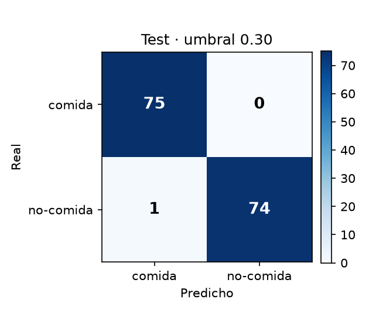
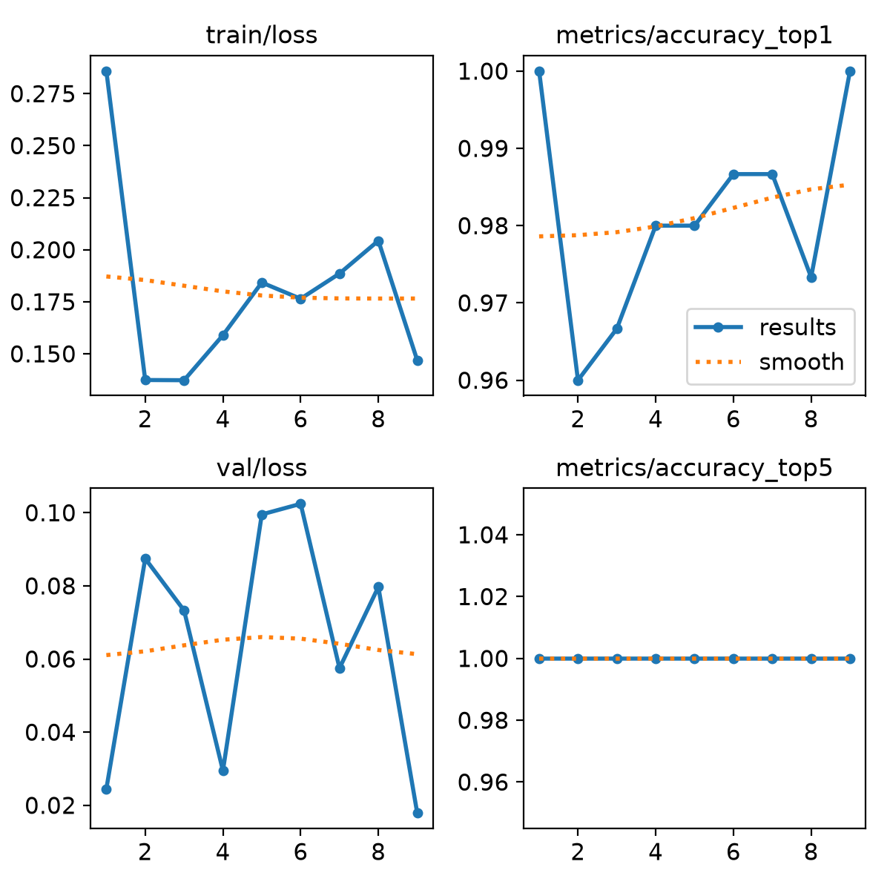

# Visión local: fotos de comida

## Objetivo

El dueño de un restaurante llena su menú con fotos. Una foto de la fachada, del
logo o de un perro no debería publicarse como plato. Tuki revisa la imagen
**antes de subirla** con un clasificador local y le dice al dueño si parece
comida.

La decisión es de producto, no académica:

- **Un falso negativo** (rechazar un plato real) cuesta una molestia y un
  reintento; debe ser raro.
- **Un falso positivo** (aceptar una foto que no es comida) degrada el menú;
  se tolera mejor mientras el dueño siga siendo quien decide.
- Si el clasificador no está disponible, **la subida continúa**. El panel no
  depende de la IA para funcionar.

## Datos

La etiqueta salió de Label Studio: una tarea por imagen y una anotación de tipo
`choices` con dos opciones, `comida` y `no comida`.

| Concepto | Cantidad |
| --- | --- |
| Tareas exportadas | 1001 |
| Anotaciones válidas | 997 |
| Comida | 500 |
| No comida | 497 |
| Descartes | 3 sin anotación, 1 `desktop.ini` |
| Reparto | 697 train / 150 val / 150 test |

El manifiesto reducido (ruta, etiqueta, split y hash) se versiona en
`datos/etiquetas/manifiesto-comida.csv`, junto a la exportación original de
Label Studio (`export-labelstudio-comida.json`). Las fotos no se versionan: son
material de sus autores y el dataset generado queda en
`services/vision-service/datos/` (ignorado por git).

`entrenamiento/preparar_dataset.py` resuelve las rutas de Label Studio contra
`~/Downloads`, descarta duplicados por SHA-256 para no filtrar una foto entre
train y test, y convierte a JPEG los archivos que OpenCV no decodifica (se
encontró un AVIF con extensión `.jpg`).

## Modelo

- Base: `yolo11n-cls.pt` (Ultralytics), 1,5 M de parámetros, ~3,3 GFLOPs.
- Entrada: 224 × 224.
- Clases: `comida`, `no-comida` (Ultralytics las ordena alfabéticamente).
- Entrenamiento: 20 épocas máximas con `patience=8` (paró en la 9; mejor
  validación en la época 1), batch 16, CPU, semilla 42.

El detalle de accuracy, precisión, recall, F1, matriz de confusión y barrido de
umbrales vive en `services/vision-service/modelos/comida-v1.metricas.json` y se
puede consultar en caliente con `GET /api/v1/vision/modelo`.

### Resultado v1 (split de prueba, 150 fotos)

| Umbral | Accuracy | Precisión | Recall | F1 | FN | FP |
| --- | --- | --- | --- | --- | --- | --- |
| 0,30 | 0,993 | 0,987 | 1,000 | 0,993 | 0 | 1 |
| 0,50 | 0,980 | 0,987 | 0,973 | 0,980 | 2 | 1 |

Se despliega en **0,30** porque no rechaza ningún plato real del conjunto de
prueba; el único error es una foto que no era comida y pasó. El entrenamiento
se detuvo en la época 9 por `patience=8` (mejor validación en la época 1).

Matriz de confusión en test con el umbral desplegado y curvas del
entrenamiento:





## Decisión

El servicio no devuelve solo la clase ganadora: devuelve
`probabilidad_comida`. La foto se acepta si esa probabilidad supera
`VISION_UMBRAL_COMIDA` (0,3 por defecto). Así el umbral se ajusta sin
reentrenar y el panel puede mostrar el porcentaje de seguridad.

`entrenamiento/evaluar.py` barre umbrales de 0,05 a 0,95 y propone el de mejor
F1 en el split de prueba. Ese valor es el que conviene fijar en producción.

## Flujo en el panel

```text
dueño elige archivo
        │
        ▼
POST /vision/api/v1/vision/clasificar   (Nginx quita /vision)
        │
        ├── es_comida = false ──► aviso y no se sube a Storage
        ├── es_comida = true  ──► comprime y sube a Supabase Storage
        └── 503 / sin red     ──► aviso en consola y sube igual
```

El navegador habla con el mismo origen (`/vision`) y Nginx/Vite lo reenvían.
La clave no existe: no hay proveedor externo. En Kubernetes, el servicio solo
acepta tráfico del pod web y no tiene salida a Internet.

## Operación

```bash
# Desarrollo
cd services/vision-service
.venv/Scripts/python -m uvicorn app.main:app --reload --port 8002

# Docker Compose (incluye el servicio `vision`)
docker compose --env-file .env.local up -d --build

# Kubernetes
docker build -t tuki-vision:local-0.3.0 services/vision-service
kubectl apply -k deploy/k8s/overlays/local
```

Sondas:

- `/healthz`: el proceso vive (no depende del modelo).
- `/readyz`: 200 solo cuando el modelo está cargado; 503 en caso contrario.
- `/api/v1/vision/modelo`: nombre, etiquetas, umbral y métricas.

## Privacidad y seguridad

- La inferencia es local; la foto no se envía a Groq ni a ningún tercero.
- El servicio corre sin privilegios, con rootfs de solo lectura y sin
  capabilities.
- No guarda las imágenes: las procesa en memoria y responde.
- Tope de 8 MB y validación real del contenido con Pillow (no se confía en el
  `Content-Type`).

## Limitaciones y siguientes pasos

- No reconoce si el plato está en el menú ni valida alérgenos.
- La métrica puede ser optimista si el dataset original tiene fotos casi
  idénticas; el reparto solo deduplica por hash exacto.
- Un plano muy cerrado puede confundir al modelo; el umbral es la válvula.
- Si se recolectan más fotos, conviene añadir una clase "dudosa" o ampliar el
  dataset con fotos oscuras y de locales reales.
- El siguiente paso natural es mostrar una vista previa con el veredicto antes
  de guardar, en lugar de solo bloquear.
